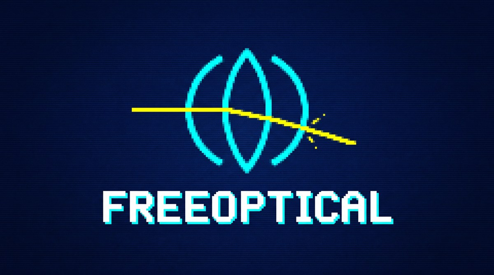

<p align="center"></p>

<p align="center"><a href="https://github.com/jbandrivet/freeoptical/actions/workflows/ci.yml"></a> <a href="https://github.com/jbandrivet/freeoptical/releases/latest"></a> <a href="#licence"></a></p>

# FreeOptical

**Français** · [English](README.en.md) · [Deutsch](README.de.md) · **Site : [jbandrivet.github.io/freeoptical](https://jbandrivet.github.io/freeoptical/)**

**Logiciel libre de conception et de simulation optique séquentielle pour Linux : interface graphique, interface terminal et serveur MCP.**

FreeOptical permet de concevoir n'importe quel système optique (objectif, lunette, télescope à miroirs, montage de test…) surface par surface, puis de l'analyser et de l'optimiser. Il est écrit en **Rust** (`egui`, `ratatui`, `nalgebra`, `rmcp`) et combine :
1. **Un moteur de lancer de rayons séquentiel 3D** : calcul paraxial ABCD, lois de Snell-Descartes vectorielles, surfaces planes, sphériques, coniques et asphériques paires, miroirs, surfaces basculées et décentrées, ruptures de repère (Coordinate Break) pour les systèmes repliés, solves et reprises (mise au point automatique, F/# imposé, surface aplanétique, valeurs recopiées), obstructions centrales, réseaux de diffraction, vrais verres (formules de Sellmeier, catalogues Zemax `.agf` Schott, Ohara, CDGM…), spot diagram polychromatique, aberration sphérique longitudinale, différence de marche (OPD) et front d'onde avec polynômes de Zernike, rapport de Strehl, PSF et FTM de diffraction, courbes de rayons, courbure de champ, distorsion, coefficients de Seidel, énergie encerclée, décalage focal chromatique et couleur latérale, empreinte des faisceaux et demi-diamètres nécessaires, import des fichiers Zemax `.zmx`, et optimisation Damped Least Squares sur tous les champs et toutes les couleurs ; test des miroirs à l'interféromètre de Bath (simulation, réduction, analyse de photos d'interférogrammes).
2. **Une interface graphique et une interface terminal (`--tui`) en français, en anglais ou en allemand** : Éditeur de Données de Lentilles (LDE), coupe 2D avec lancer de rayons, vue 3D orientable, spot diagram, LSA, catalogue de verres, front d'onde, PSF et FTM. On part d'un système vierge (`Fichier` → `Nouveau système vierge`) ou de l'un des exemples fournis comme point de départ.
3. **Un serveur Model Context Protocol (MCP) intégré** permettant à un agent IA de concevoir, simuler et optimiser des systèmes optiques.

---

## Installation (Debian / Ubuntu, amd64)

Télécharger le paquet `.deb` de la [dernière version](https://github.com/jbandrivet/freeoptical/releases/latest), puis :
```bash
sudo apt install ./freeoptical_*_amd64.deb
```
Les versions suivantes s'installent ensuite depuis le bouton **Mise à jour** de la fenêtre graphique.

Depuis les sources : `cargo build --release` ; le paquet se construit avec `./packaging/make-deb.sh`.

---

## Utilisation

### 1. Mode Exécutable Graphique Autonome (ou TUI `--tui`)
```bash
freeoptical
# Ou en chargeant un fichier système JSON :
freeoptical --fichier systeme_optique.json
# Ou en important un fichier Zemax séquentiel, ou TDESIGN / LENSDES / RAYTRACE :
freeoptical --fichier objectif.zmx
freeoptical --fichier RITCHRET.TDS
# Choisir la langue de l'interface :
freeoptical --langue fr
```

#### Raccourcis clavier dans l'interface terminal :
- **`Flèches` / `Tab`** : Naviguer dans l'Éditeur de Données de Lentilles (LDE)
- **`Entrée` / `E`** : Modifier la cellule sélectionnée (Rayon, Épaisseur, Verre, Demi-diamètre, Conique, Commentaire)
- **`F10` / `M`** : Ouvrir la barre de menu supérieure (`Fichier`, `Édition`, `Analyse`, `Outils`, `Langue`)
- **`F1` / `1`** : Vue 1 — Coupe Transversale 2D & Lancer de Rayons
- **`F2` / `2`** : Vue 2 — Projection 3D Isométrique Filaire (`H`/`L` : Lacet, `J`/`K` : Tangage)
- **`F3` / `3`** : Vue 3 — Spot Diagram Polychromatique & Disque d'Airy
- **`F4` / `4`** : Vue 4 — Aberration Sphérique Longitudinale (LSA)
- **`F5` / `5`** : Vue 5 — Catalogue de Verres (`BK7`, `F2`, `SF11`, `SILICE`, `LAK9`, `SK16`, `BAF10`, `FK51A`...)
- **`F6` / `6`** : Vue 6 — Front d'onde (OPD), coefficients de Zernike et Strehl
- **`F7` / `7`** : Vue 7 — Tache image de diffraction (PSF)
- **`F8` / `8`** : Vue 8 — FTM tangentielle et sagittale de tous les champs
- **`9`** : Courbes de rayons (aberrations transverses) ; **`0`** : Courbure de champ et distorsion ; coefficients de Seidel par le menu `Analyse`
- **`Maj+F1`** : Énergie encerclée ; **`Maj+F2`** : Décalage focal chromatique et couleur latérale ; **`Maj+F3`** : Empreinte des faisceaux (`[` / `]` : surface précédente / suivante) — aussi `F13` à `F15`, et par le menu `Analyse`
- **`B`** : Interféromètre de Bath pour le miroir du système (`X`/`x`, `Y`/`y` : basculement, `D`/`d` : défocalisation, `F` : franges droites, `E`/`e` : écart, `K`/`k` et `V`/`v` : coniques réelle et visée, `A` : astigmatisme, `Échap` : fermer)
- **`C`** / **`W`** : Champ suivant / longueur d'onde suivante pour les vues d'analyse
- **`I` / `Ins`** : Insérer une surface avant la ligne sélectionnée
- **`A`** : Ajouter une surface avant le Plan Image
- **`Suppr` / `X`** : Supprimer la surface sélectionnée
- **`T`** : Basculer le type de surface (`PLANE` → `SPHERIQUE` → `CONIQUE` → `ASPHERIQUE` → `COORDBRK`) ; une valeur calculée par un solve est suivie de `S`
- **`S`** : Définir la surface sélectionnée comme Diaphragme (`STOP`)
- **`O`** : Optimiser automatiquement le système par **Damped Least Squares (DLS)**
- **`P`** : Mise au point paraxiale automatique (ajuste le tirage sur le `BFL`)
- **`F12`** : Changer de langue (français → anglais → allemand)
- **`Q`** : Quitter

#### Langue de l'interface
FreeOptical s'affiche en français, en anglais ou en allemand : menu `Langue` (fenêtre graphique et TUI), touche `F12` dans le TUI, ou option `--langue fr|en|de`. Le choix est enregistré dans `~/.config/freeoptical/langue` ; au premier démarrage, c'est la langue du système (`LANG`) qui est prise. Les noms des outils MCP, des champs JSON et des matériaux (`AIR`, `MIROIR`) sont les mêmes dans toutes les langues ; les descriptions des outils MCP et les messages suivent la langue choisie.

Dans la fenêtre graphique, le menu `Fichier` propose **Ouvrir…** (`Ctrl+O`), **Enregistrer** (`Ctrl+S`) et **Enregistrer sous…** (`Ctrl+Maj+S`) : un navigateur de dossiers avec des raccourcis vers le dossier personnel, le Bureau, les Téléchargements et les Documents, qui ouvre les systèmes `.json`, les fichiers Zemax `.zmx`, `.TDS`, `.RLD`, `.DES` et les catalogues `.agf`, et se souvient du dernier dossier utilisé. En quittant (croix de la fenêtre ou `Fichier` → `Quitter`), FreeOptical propose d'enregistrer un système modifié. Les exemples fournis sont dans `Fichier` → `Exemples`. On peut aussi glisser un fichier sur la fenêtre.
Le bouton **`Mise à jour`** (en bas à droite, ou menu `Outils`) cherche la dernière version publiée sur GitHub ; si elle est plus récente, il télécharge le paquet `.deb`, vérifie son empreinte SHA-256 et l'installe avec `apt-get` (le mot de passe administrateur est demandé par `pkexec`), puis propose de redémarrer FreeOptical.
Les coefficients asphériques A4, A6, A8, A10 de la surface sélectionnée s'éditent sur la ligne au-dessus du tableau LDE (glisser : 0,1 µm de flèche au bord par pixel ; clic : saisie directe, ex. `2.1e-7`) ; modifier un coefficient passe la surface en type `ASPHERIQUE`.

#### Fenêtre graphique : vues et réglages
- Onglets **Maj+F1** à **Maj+F3** : **énergie encerclée** (géométrique, par diffraction et tache d'Airy ; rayons à 50 et 80 %), **chromatisme** (décalage du foyer paraxial selon la longueur d'onde, comparé à la profondeur de foyer ±2λN², et couleur latérale le long du champ, comparée au rayon d'Airy), **empreinte** des faisceaux de tous les champs sur la surface choisie, avec le demi-diamètre nécessaire et le bouton **Ajuster tous les demi-diamètres**.
- Ligne **Solves** de la surface sélectionnée : listes déroulantes pour le rayon, l'épaisseur et la conique ; la valeur calculée apparaît en orange suivie de `S` dans le tableau.
- Onglets **F1** à **F11** sous l'éditeur : coupe 2D, vue 3D, spot, LSA, verres, front d'onde, PSF, FTM, **courbes de rayons** (aberrations transverses et différence de marche le long des coupes tangentielle et sagittale), **courbure de champ et distorsion**, **coefficients de Seidel** par surface.
- Sous les coefficients asphériques, la ligne de la surface sélectionnée règle son **décentrement** (X, Y), son **inclinaison** (autour de X puis de Y, en degrés, autour du sommet), le rayon de son **obstruction centrale** et un **réseau de diffraction** (traits par mm, ordre).
- Le bouton **Optimiser DLS** ouvre la fonction de mérite : variables (rayons, épaisseurs des lentilles, espaces d'air, tirage, coniques, asphériques A4/A6), critère (spot RMS ou front d'onde RMS sur tous les champs et toutes les longueurs d'onde), focale cible et contraintes (épaisseurs au bord et au centre, longueur totale, distorsion).

#### Verres
Les verres intégrés (N-BK7, N-K5, F2, SF2, N-SF5, N-SF6, N-SF11, N-LAK9, N-SK16, N-BAF10, N-FK51A, N-PK52A, silice fondue, fluorine CaF2) suivent leurs formules de Sellmeier ; leurs anciens noms (BK7, SF11…) restent acceptés. Les catalogues Zemax **`.agf`** (Schott, Ohara, CDGM, Sumita…, en ANSI ou UTF-16) s'importent par le menu `Fichier`, par glisser-déposer, par `--catalogue fichier.agf` ou par l'outil MCP `importer_catalogue_agf` ; ils sont conservés dans `~/.config/freeoptical/verres` et rechargés à chaque démarrage. La syntaxe `nd:Vd` reste disponible pour un verre modèle.

#### Surfaces basculées, obstructions et réseaux
- Chaque surface est placée à la position donnée par les épaisseurs le long de l'axe courant, puis décentrée et inclinée autour de son sommet (pour elle seule) ; le lancer de rayons est exact en 3D. Les calculs paraxiaux (focale, pupilles, Seidel) suivent l'axe déplié et ignorent les bascules et les réseaux.
- **Rupture de repère** (type `COORDBRK`, le *Coordinate Break* de Zemax) : surface fictive qui décentre (X, Y) puis incline (autour de X, du nouvel Y, du nouveau Z) le repère de **toutes les surfaces suivantes** ; son épaisseur se compte le long du nouvel axe. Case « inclinaison avant décentrement » = ordre 1 de Zemax (rotations Z, Y, X puis décentrement) : avec les valeurs opposées, elle défait exactement une rupture précédente. Un Newton s'écrit comme dans Zemax : primaire (épaisseur négative), rupture de 45°, miroir plan, rupture de 45°, tirage, plan image — qui se retrouve perpendiculaire au faisceau sans réglage.
- Une obstruction centrale arrête les rayons qui passent à moins de son rayon de l'axe de la surface ; le spot, le front d'onde, la PSF et la FTM en tiennent compte (le rayon principal de référence est tracé sans obstruction).
- Réseau de diffraction : équation vectorielle des réseaux, traits parallèles à l'axe X local de la surface, un ordre positif dévie la lumière vers +Y local ; en réflexion sur un miroir, en transmission sinon.

#### Objets proches, systèmes afocaux et spectrographes
- **Paramètres du système** (menu `Édition`) : objet à l'infini (champs en degrés) ou à distance finie (champs en hauteurs d'objet, mm : microscopes, relais, projecteurs, fente de spectrographe), ouverture (pupille d'entrée, F/# ou ouverture numérique objet), champs et longueurs d'onde avec poids et référence. Le tirage paraxial devient la distance de l'image et le bilan affiche le grandissement.
- **Espace image afocal** (oculaires, lunettes de visée, jumelles, élargisseurs de faisceau) : spot et PSF en µrad, FTM en cycles/mrad, front d'onde rapporté à une onde plane, courbure de champ en dioptries, grossissement angulaire.
- **Lentille idéale** (type `IDEALE`, focale réglable) : lentille parfaite pour tous les conjugués, pour simuler un collimateur ou une caméra idéale, ou regarder l'image d'un système afocal.
- **Spectrographe** (vue **F12**) : position de chaque longueur d'onde sur le détecteur, dispersion linéaire inverse (nm/mm), tache par longueur d'onde, image de la fente et pouvoir de résolution R = λ/Δλ, pour une largeur de fente en µm (objet proche) ou en secondes d'arc (objet à l'infini) ; le spot diagram peut centrer chaque longueur d'onde sur son propre centroïde. Exemple fourni : `Fichier` → `Charger un spectrographe à réseau`.

#### Analyses ondulatoires : front d'onde, PSF et FTM
Les vues `F6`, `F7` et `F8` (fenêtre graphique et TUI) s'appliquent au champ et à la longueur d'onde choisis (ou à toutes les longueurs d'onde pondérées).
- **Front d'onde** : différence de marche rapportée à la sphère de référence centrée sur l'image du rayon principal et passant par la pupille de sortie paraxiale (convention de Zemax), positive quand le chemin optique du rayon est plus long ; crête-à-creux, RMS, Strehl de Maréchal et 37 coefficients de Zernike (normalisation et ordre de Noll).
- **PSF** : figure de diffraction de Fraunhofer par FFT de la pupille, polychromatique ou à une longueur d'onde, échelle linéaire ou logarithmique ; le rapport de Strehl est le pic de la PSF rapporté à celui de la même pupille sans aberration. L'échantillonnage s'adapte à la taille de la tache pour éviter le repliement.
- **FTM** : module de la transformée de Fourier de la PSF, tangentielle et sagittale pour chaque champ, avec la limite de diffraction de la pupille.
- Vérifié par les tests : parabole parfaite (Strehl 1, FTM égale à la formule de la pupille circulaire), défocalisation (Strehl exact sinc²), aberration sphérique d'un miroir sphérique et coma d'une parabole conformes aux formules du 3e ordre, centre de gravité de la PSF égal à celui du spot diagram.

#### Interféromètre de Bath (test des miroirs au centre de courbure)
- `Outils` → `Interféromètre de Bath` (touche `B` dans le TUI). **Simulation** : miroir (diamètre, rayon de courbure, conique réelle et conique visée, obstruction), montage (longueur d'onde, écart source – référence et sa direction), réglages en franges (basculement X/Y, défocalisation ; bouton « franges les plus droites ») et défauts de surface (Zernike, zone, bord rabattu ou relevé). Les chemins sont calculés exactement (`|SM| + |MQ|` sur la flèche exacte de la conique) : l'astigmatisme de Bath dû à l'écart `s` (s²D²/16R³ crête-à-creux) apparaît de lui-même.
- **Réduction** : la carte est comparée à celle du miroir parfait de conique visée dans le même montage (sphérique au centre de courbure et astigmatisme de Bath déduits), piston, basculements et défocalisation retirés (l'astigmatisme sur demande) : conique mesurée, crête-à-creux et RMS du front d'onde (au λ du laser et à 550 nm) et de la surface (nm), Strehl à 550 nm, carte d'erreur et Zernike de l'écart.
- **Analyse d'une photo** (PNG, JPEG, BMP, TIFF, qu'on peut glisser sur la fenêtre) : le disque du miroir est repéré automatiquement (réglable à la main ou à la souris), le front d'onde extrait par la méthode de Takeda (FFT, extrapolation de Gerchberg, déroulement guidé par la qualité, affinement local puis ajustement global du modèle d'image sur 37 Zernike) et réduit comme ci-dessus. Il faut une dizaine à une vingtaine de franges de basculement, mise au point réglée pour des franges aussi droites que possible. Une seule photo ne distingue pas bosse et creux : le signe est choisi automatiquement (le plus proche de la conique visée) ou imposé.
- Vérifié par les tests : sphère sans écart = teinte plate, réglages en franges exacts, astigmatisme de Bath et sphérique de la parabole conformes aux formules, conique et défauts retrouvés ; sur des photos simulées (bruit, éclairage gaussien, obstruction centrale), conique retrouvée à ±0,005 et RMS à ±0,003 λ, disque repéré à mieux d'un pixel.
- L'exemple `Fichier` → `Charger Interféromètre de Bath` est le montage séquentiel correspondant : lentille de Bath idéale (ses aberrations se compensent dans le vrai montage) et miroir pris comme pupille ; son front d'onde (F6) montre l'écart du miroir à la sphère.

#### Solves et reprises (pickups)
Calculs automatiques refaits avant chaque analyse et à chaque pas de l'optimiseur (un paramètre calculé ne peut pas être variable), surface par surface, le rayon avant l'épaisseur :
- **Épaisseur** : *hauteur marginale* (le rayon marginal arrive à la hauteur `h` sur la surface suivante ; `h = 0` = mise au point ; `zone` ≠ 0 : rayon réel à cette fraction de la pupille, 0,7071 pour le meilleur foyer en présence de sphérique), *hauteur principale* (`h = 0` : surface suivante dans une pupille).
- **Rayon** : *angle marginal* ou *angle principal* imposé après la surface, *nombre d'ouverture* (la dernière courbure fixe le F/#), *aplanétique* (ni sphérique ni coma pour le rayon marginal).
- **Reprise** (rayon, épaisseur ou conique) : valeur d'une autre surface × facteur + décalage (lentille symétrique : R2 = −1 × R1).
- Un solve impossible (rayon parallèle, surface inexistante…) est signalé et la valeur précédente conservée.

#### Import des fichiers Zemax `.zmx`
Fichiers de lentilles OpticStudio séquentiels (UTF-16 ou ASCII) : menu `Fichier` → `Ouvrir…`, glisser-déposer, option `--fichier` ou outil MCP `importer_zemax`.
- Sont repris : surfaces `STANDARD`, `EVENASPH` (r⁴ à r¹⁰), `COORDBRK`, `PARAXIAL`, `DGRATING`, courbures, épaisseurs, coniques, verres (par leur nom s'il est connu — catalogues intégrés ou `.agf` importés —, sinon par leur modèle nd/Vd), `MIRROR`, demi-diamètres (calculés s'ils sont nuls), `CLAP` et `OBSC`, diaphragme, unités (mm, cm, m, pouces), pupille (`ENPD`, `FNUM`, `OBNA`, `FLOA`), champs en angle, en hauteur objet ou en hauteur image (convertis), longueurs d'onde et longueur d'onde principale.
- Les solves de Zemax sont repris avec leurs valeurs du moment, figées ; les autres types de surface sont importés comme surfaces standard et tout ce qui n'est pas repris est listé dans le bilan de l'import.

#### Import des fichiers TDESIGN, LENSDES et RAYTRACE
FreeOptical lit les fichiers de conception des programmes du livre *Telescope Optics: Evaluation and Design* (H. G. J. Rutten et M. A. M. van Venrooij, Willmann-Bell, 1988) : `.TDS` (TDESIGN, télescopes à miroirs et catadioptriques), `.RLD` (LENSDES, objectifs de lunette) et `.DES` (RAYTRACE). Menu `Fichier` → `Ouvrir…`, option `--fichier`, ou outil MCP `importer_teloptik`.
- Sont repris : sphères, coniques, asphères (coefficients en r² à r¹⁰), lames de Schmidt définies par leur puissance relative et leur zone neutre (profil du 3e ordre), miroirs (changement de signe de l'indice, y compris dans le verre d'un Mangin), décalages axiaux, indices N1/N2/N3 convertis en verre `nd:Vd`, diamètres limites quand le vignettage était activé dans RAYTRACE.
- Le plan image est placé au foyer paraxial et les demi-diamètres sont calculés pour laisser passer le faisceau sur l'axe et à 0,5° de champ.
- Les obstructions centrales sont reprises quand le vignettage était activé dans RAYTRACE ; les fichiers basculés ou décentrés sont refusés, la convention de placement de RAYTRACE n'étant pas connue avec certitude.
- La focale inscrite dans l'en-tête est comparée à la focale recalculée : elles coïncident pour les fichiers enregistrés par RAYTRACE ; les avant-projets de TDESIGN gardent la focale visée, sans la puissance du correcteur.

#### Conventions optiques
- **Diaphragme (`STOP`)** : la pupille d'entrée est l'image paraxiale du diaphragme ; les rayons hors axe sont visés au centre de cette pupille.
- **Miroirs** (verre `MIROIR`) : convention Zemax, les épaisseurs qui suivent un miroir sont négatives (la lumière repart vers -Z). La focale d'un miroir concave est positive ; le tirage (BFL) est compté le long de Z.
- **Ouverture** : `PupilleEntreeMm`, `NombreOuverture` (F/# = EFFL / EPD) ou `OuvertureNumeriqueObjet` (objet à l'infini : rapportée à l'espace image, F/# = 1 / 2NA).
- **Verres** : un nom inconnu du catalogue est traité comme de l'air (un avertissement s'affiche dans le TUI et le MCP) ; syntaxe libre `nd:Vd`, ex. `1.5168:64.17`.
- **Fichiers JSON** : seuls `nom` et `surfaces` sont obligatoires (catalogue, longueurs d'onde, champs, conique, etc. prennent des valeurs par défaut).

---

### 2. Mode Serveur MCP (Model Context Protocol)
```bash
freeoptical --mcp
```

#### Outils MCP exposés sur `stdio` :
- `creer_systeme(nom, longueur_onde_ref)` : Initialise un nouveau design optique.
- `ajouter_surface(type, rayon, epaisseur, verre, semi_diametre)` : Ajoute un dioptre ou un miroir.
- `modifier_surface(index, parametres)` : Modifie les propriétés d'une surface existante.
- `lancer_simulation()` : Exécute le lancer de rayons séquentiel et retourne les données paraxiales, les rayons 3D et la LSA.
- `obtenir_spot_diagram()` : Retourne les coordonnées des impacts au plan image, le centroïde, le rayon RMS et le rayon d'Airy.
- `optimiser_systeme(variables, cibles)` : Exécute l'optimiseur Damped Least Squares (DLS).
- `importer_teloptik(chemin)` : Importe un fichier `.TDS`, `.RLD` ou `.DES` (TDESIGN, LENSDES, RAYTRACE) comme système courant.
- `importer_zemax(chemin)` : Importe un fichier Zemax séquentiel `.zmx` comme système courant.
- `analyser_energie_encerclee(champ_index)` : énergie encerclée géométrique, par diffraction et d'Airy, rayons à 50 et 80 %.
- `analyser_chromatisme()` : décalage focal chromatique et couleur latérale.
- `analyser_empreinte(index_surface, ajuster_demi_diametres, points)` : empreinte des faisceaux sur une surface et demi-diamètres nécessaires (appliqués sur demande).
- `analyser_front_onde(champ_index, longueur_onde_nm)` : Front d'onde d'un champ : crête-à-creux, RMS, Strehl (Maréchal et PSF), 37 coefficients de Zernike.
- `calculer_ftm(champ_index, longueur_onde_nm, nb_frequences)` : FTM tangentielle et sagittale, limite de diffraction et Strehl de la PSF.
- `analyser_aberrations(champ_index, longueur_onde_nm)` : coefficients de Seidel par surface, courbure de champ et distorsion, courbes de rayons.
- `importer_catalogue_agf(chemin)` : importe un catalogue de verres Zemax `.agf`.
- `definir_systeme(...)` : objet (infini ou distance), afocal, ouverture, champs, longueurs d'onde.
- `analyser_spectre(champ_index, lambda_min_nm, lambda_max_nm, nb, largeur_fente)` : positions, dispersion, tache, image de fente et résolution d'un spectrographe.
- `simuler_bath(parametres, chemin_png)` : interférogramme d'un miroir au centre de courbure et sa réduction (conique mesurée, PV/RMS, Strehl, Zernike), PNG facultatif.
- `analyser_interferogramme(chemin, parametres, disque, marge_pct, signe)` : analyse et réduction de la photo d'un interférogramme de Bath.
- `modifier_surface` accepte aussi `solve_rayon`, `solve_epaisseur`, `solve_conique` (ex. `{"type":"HauteurMarginale","hauteur_mm":0,"zone":0}`, `{"type":"NombreOuverture","f_nombre":8}`, `{"type":"Reprise","surface":1,"facteur":-1,"decalage":0}`), `retirer_solves`, `inclinaison_z_deg`, `inclinaison_avant_decentrement` (ruptures de repère `COORDBRK`), `decentrement`, `inclinaison_deg`, `rayon_obstruction`, `reseau_traits_mm` et `reseau_ordre` ; `optimiser_systeme` accepte les variables `a4` à `a10` et les cibles `spot_rms_champs`, `opd_rms_champs`, `longueur_totale_max`, `distorsion_max`, `epaisseur_centre_min`, `epaisseur_bord_min`.

---

## Contribuer

FreeOptical est un projet ouvert : chacun peut l'améliorer. Signalez un bug ou proposez une idée dans les [issues](https://github.com/jbandrivet/freeoptical/issues), posez vos questions dans les [discussions](https://github.com/jbandrivet/freeoptical/discussions), ou proposez directement du code par pull request. Le guide [CONTRIBUTING.md](CONTRIBUTING.md) explique comment compiler, tester et proposer une modification.

---

## Licence

FreeOptical est distribué sous double licence, au choix :

- Licence Apache, version 2.0 ([LICENSE-APACHE](LICENSE-APACHE))
- Licence MIT ([LICENSE-MIT](LICENSE-MIT))
